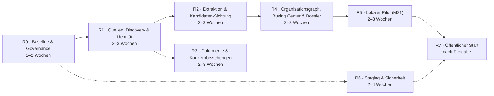

# Masterplan: Vom Vertriebsarbeitsplatz zur Open Intelligence Plattform

> **Erzeugt aus [`plan/open_intelligence.json`](plan/open_intelligence.json) mit `python tools/plan_status.py --write` – nicht von Hand ändern.**
> Quelle: [Architektur- und Masterplan vom 25.11.2026](quellen/SignalDesQ_Architektur_Masterplan_2026-11-25.pdf) · Referenzstand main 56632442 (2.0.0-dev65), Planstand 25.11.2026 · eingearbeitet in 2.0.0-dev66 (R0 abgeschlossen in 2.0.0-dev67). Status je Paket: **offen** = noch nicht begonnen, **teilweise** = Grundlage im Code vorhanden, Abnahme noch nicht erfüllt, **erledigt** = umgesetzt und automatisch geprüft (mit Version und Nachweis) – nicht praxisvalidiert, **blockiert** = wartet auf eine Entscheidung oder einen Nachweis außerhalb des Engineerings.

**Empfohlener Kurs.** Den lokalen Kern bewahren. Öffentliche Unternehmensdaten über kontrollierte Recherche, nachvollziehbare Belege und eine Organisationsansicht verwertbar machen. SaaS erst nach messbarem Produktnutzen und geschlossenen Sicherheits-Gates.

**Produktversprechen.** Recherchiere nachvollziehbar, wer für dein Angebot relevant ist und welche Bedarfshinweise es gibt – mit belegten Fakten, transparenten Lücken und ohne verpflichtende Datenanbietergebühren.

**Wirtschaftlicher Kernindikator.** Kosten und Zeit je korrekt identifiziertem, relevantem und überprüftem Ansprechpartner. **Priorisierung:** Zuerst richtig finden, dann richtig zuordnen, erst danach visualisieren.

**Stand aller 56 Arbeitspakete:** 19 offen · 20 teilweise · 8 erledigt · 9 blockiert.

## Inhalt

1. [Unverhandelbare Regeln](#unverhandelbare-regeln)
2. [Phasen und kritischer Pfad](#phasen-und-kritischer-pfad)
3. [Arbeitspakete je Phase](#arbeitspakete-je-phase)
4. [Sicherheitsbefunde F01–F12](#sicherheitsbefunde-f01f12)
5. [Kennzahlen und Gates](#kennzahlen-und-gates)
6. [Reifeprofil](#reifeprofil)
7. [Technologieregister](#technologieregister)
8. [Skills](#skills)
9. [Entscheidungen außerhalb des Engineerings](#entscheidungen-außerhalb-des-engineerings)
10. [Bezug zur bisherigen Roadmap](#bezug-zur-bisherigen-roadmap)
11. [So wird der Plan gepflegt](#so-wird-der-plan-gepflegt)

## Unverhandelbare Regeln

1. Lokale Installation, Offline-Modus, Buchhaltung, Angebote, CRM, Kontakt- und Sperrregeln bleiben funktionsfähig; der Kern braucht keine kostenpflichtigen Daten-APIs, API-Keys oder externe KI.
2. Keine automatisierte Werbeansprache. Eine Rolle, ein Bedarfssignal oder eine Adresse ist keine Werbeerlaubnis.
3. Keine erfundenen Namen, Kontaktwege, Quellen, Hierarchien, Scores oder Testergebnisse; kein Claim ohne prüfbaren Beleg.
4. Öffentliche Zugänglichkeit ist keine Nutzungserlaubnis: keine Umgehung von Zugriffssperren, CAPTCHAs, robots-Regeln oder Plattformbedingungen; kein LinkedIn-/XING-/Suchmaschinen-Scraping, keine Massenabrufe.
5. Nur zweckgebundene berufliche Angaben; keine privaten oder sensiblen Daten. Personenbezogene Kandidaten bleiben bis zur menschlichen Prüfung außerhalb der CRM-Kontakte.
6. Externe Texte und Dokumente sind Daten, keine Befehle. Parser und Modelle arbeiten ohne Netz-, Schreib- oder Shell-Rechte.
7. Namensgleichheit ist kein Identitätsbeweis; zwei bestätigte Rollen beweisen keine Hierarchie.
8. Keine öffentliche Registrierung oder Produktivfreigabe bei offenen hohen/kritischen Befunden, fehlender Gegenprüfung oder ungetesteter Wiederherstellung.
9. Rote Release-Gates werden behoben, nicht deaktiviert. Ein Fehler ist ein Teilergebnis, kein negativer Befund.
10. Diese Planquelle und docs/ROADMAP.md sind die einzigen Statusquellen; Berichte trennen Ist, getestet, geplant, blockiert und nicht gemessen.

## Phasen und kritischer Pfad

Durchgezogene Pfeile: kritischer Pfad R0 → R1 → R2 → R4 → R5 → R7. Gestrichelt: parallel (R3 nach R1; R6 beginnt nach R0 und muss vor R7 abgeschlossen sein).

| Phase | Name | Aufwand* | Beginnt nach | Ziel | Abnahme (Gate) | Pakete |
|---|---|---|---|---|---|---|
| **R0** | Baseline & Governance | 1–2 Wochen | – | Reproduzierbare Ausgangslage, eine Versionswahrheit, verbindliche Regeln, Skills und Sicherheits-Gates, bevor neue Recherchefunktionen entstehen. | Reproduzierbare Baseline (Unit, Browser, Python 3.10/3.13, CI-Matrix) mit Commit dokumentiert Je Befund F01–F12 ein Verantwortlicher und ein Nachweisweg README/ROADMAP/Einschränkungen nennen die aktuelle Version | 8 erledigt |
| **R1** | Quellen, Discovery & Identität | 2–3 Wochen | R0 | Nur erlaubte Quellen, gezielte Seitensuche auf bekannten Websites, verlässliche Firmenidentität und eine unabhängige Referenzliste. | Source Registry sperrt ungeprüfte Quellen Domain-Referenztest auf der Referenzliste gemessen (Company Match Precision) Keine Regression im Abruf (Benchmark tools/bench_fetch.py) | 3 offen · 3 teilweise · 1 blockiert |
| **R2** | Extraktion & Kandidaten-Sichtung | 2–3 Wochen | R1 | Personen und Rollen aus strukturierten und unstrukturierten Seiten mit vollständigem Beleg; Sichtung ohne automatische CRM-Übernahme. | Präzision und Recall der Rollen auf der Referenzliste gemessen Sperren erreichen Kandidaten Kein Kandidat gelangt ohne menschliche Freigabe ins CRM | 3 offen · 3 teilweise |
| **R3** | Dokumente & Konzernbeziehungen | 2–3 Wochen | R1 | PDF/XML/CSV sicher und isoliert auswerten; GLEIF-Level-2-Beziehungen als belegte Konzernkanten. Läuft parallel nach R1; nicht auf dem kritischen Pfad. | Dokumentgrenzen (Größe, Zeit, Seiten) erzwungen Jeder Wert mit Seiten- bzw. Feldbeleg Parser ohne Netz- und Dateisystemzugriff außerhalb seines Arbeitsordners | 4 offen · 1 teilweise |
| **R4** | Organisationsgraph, Buying Center & Dossier | 2–3 Wochen | R2 | Belegte Rollen-, Abteilungs- und Konzernbeziehungen in der Firmenakte; Buying Center und Sales-Dossier mit getrennten Bewertungen. | Null unbelegte bestätigte Kanten UX-Test der Graph-Ansicht Fit, Quellenqualität, Rollenrelevanz und bestätigter Bedarf getrennt | 5 offen · 2 teilweise |
| **R5** | Lokaler Pilot (M21) | 2–3 Wochen | R4 | Messung an mindestens 100 Firmen und mit echten Pilotaufgaben; Fehler beheben; Kernabläufe regressionsgeprüft. | Referenzmessung an ≥ 100 Firmen gegen die Zielwerte ≥ 80 % der Pilotaufgaben ohne Hilfe, keine Datenverluste Restore und fachliche Exporte (Angebot, Rechnung) regressionsgeprüft | 1 offen · 2 teilweise · 3 blockiert |
| **R6** | Staging & Sicherheit | 2–4 Wochen | R0 | Isoliertes Staging, Betriebs- und Sicherheitsmaßnahmen F05–F12, unabhängige Nachprüfung, geschlossene Beta. Betriebsmaßnahmen beginnen früh parallel; die Freigabe (Gate) liegt vor R7. | Unabhängige Security-Nachprüfung je Commit/Artefaktdigest bestanden Restore auf leerem System geübt Geschlossene Beta nur nach Freigabe | 2 offen · 8 teilweise · 2 blockiert |
| **R7** | Öffentlicher Start | nach Freigabe | R5, R6 | Support, Betrieb, Tarif und Onboarding; öffentlicher Start nur bei erfüllten Gates. | Alle Gates erfüllt Incident- und Rollbackplan geübt | 1 offen · 1 teilweise · 3 blockiert |

\* Grobe Schätzung des Plans für einen Entwickler mit Claude-Unterstützung, ohne Garantie; R0–R6 seriell etwa 13–21 Wochen. Abhängigkeiten und Freigaben gehen vor Kalenderdaten.

## Arbeitspakete je Phase

### R0 – Baseline & Governance

*Reproduzierbare Ausgangslage, eine Versionswahrheit, verbindliche Regeln, Skills und Sicherheits-Gates, bevor neue Recherchefunktionen entstehen.*

| ID | Paket | Prio | Status | Verantwortlich | Abhängig von | Abnahme |
|---|---|---|---|---|---|---|
| **R0.1** | Baseline messen und dokumentieren | P0 | erledigt | Engineering | – | Baseline-Bericht mit Commit, Zählern und Laufzeiten Kein übersprungener Browser-Test |
| **R0.2** | Versionswahrheit | P0 | erledigt | Engineering | – | Test schlägt fehl, wenn eine Statusquelle eine andere Version nennt |
| **R0.3** | CLAUDE.md mit unverhandelbaren Regeln | P0 | erledigt | Engineering | – | Jede Regel verweist auf die Stelle im Code oder Test, die sie durchsetzt |
| **R0.4** | Skills-Register und Skill dependency-security | P0 | erledigt | Engineering | – | Jeder Skill mit Auslöser, Ein-/Ausgabe, Abnahmetest und Grenzen Externe Originale mit Commit gepinnt |
| **R0.5** | Dependency- und Code-Gates in CI | P0 | erledigt | Engineering | R0.4 | CI rot bei bekannter Schwachstelle oder Geheimnis (Code und Historie) Keine ungeprüften Downloads: Werkzeuge nur mit Hash bzw. SHA-256 |
| **R0.6** | Security-Gate-Matrix F01–F12 | P0 | erledigt | Engineering | – | Jeder Befund mit Verantwortlichem, Gate-Tests (existieren, automatisch geprüft) und offenem Nachweis Weg der externen Nachprüfung beschrieben (docs/SICHERHEITS_NACHPRUEFUNG.md); Termin ist Entscheidung E7 |
| **R0.7** | Gate-Tests Sperre und Mandant über alle Wege | P0 | erledigt | Engineering | – | Ein Test je Weg, der ohne die Regel rot wird |
| **R0.8** | Planstruktur und Phasenzuordnung | P0 | erledigt | Engineering | – | Strukturtest grün; generierte Dokumente aktuell |

- **R0.1 Baseline messen und dokumentieren.** HEAD, Version, Unit- und Browser-Suite, Python 3.10/3.13, CI-Matrix, übersprungene Tests mit Grund, Laufzeiten; Ergebnis als docs/BASELINE_<version>.md.
  Baut auf: `tools/run_e2e.py`, `tools/perf_report.py`, `.github/workflows/tests.yml`, `.claude/skills/qa-release-gate`.
  Neu: `tools/baseline.py`, `docs/BASELINE_<version>.md`.
  Stand: 2.0.0-dev67: tools/baseline.py (Unit Python 3.13 und 3.10, Browser) → docs/BASELINE_2.0.0-dev67.md mit Commit, Zählern, Überspringungen samt Grund, Fehlermeldungen und Laufzeiten. Vier Läufe deckten zwei Wettläufe in Tests auf (behoben) und einen seltenen Fehler im Browser-Test test_company_file_page (offen, siehe R5.4).
- **R0.2 Versionswahrheit.** README, ROADMAP und EINSCHRAENKUNGEN nennen die Version aus sales_tool/__init__.py; ein Test verhindert neue Abweichungen.
  Baut auf: `sales_tool/__init__.py`, `CHANGELOG.md`.
  Neu: `tests/test_plan_structure.py`.
  Stand: 2.0.0-dev66, tests/test_plan_structure.py (test_status_sources_name_current_version).
- **R0.3 CLAUDE.md mit unverhandelbaren Regeln.** Regeln aus Abschnitt A des Masterauftrags und dieser Planquelle als CLAUDE.md; Verweis auf serverseitige Kontrollen (Sperren, Belege, Mandanten).
  Baut auf: `.claude/skills/privacy-and-contact-guardrails`.
  Neu: `CLAUDE.md`, `tests/test_claude_rules.py`.
  Stand: 2.0.0-dev67: CLAUDE.md mit 11 Regeln, jede mit Durchsetzungsstelle und Test; tests/test_claude_rules.py prüft, dass alle Verweise existieren und kein Versand-Code vorhanden ist.
- **R0.4 Skills-Register und Skill dependency-security.** docs/SKILLS_REGISTRY.md: Auswahl externer Skills (Original-Repo, gepinnter Commit, Lizenz, Ausführungsrechte, Zweck); keine blind installierten Marketplaces, Hooks oder MCP-Server. Projekt-Skill dependency-security.
  Baut auf: `.claude/skills/`.
  Neu: `docs/SKILLS_REGISTRY.md`, `.claude/skills/dependency-security/SKILL.md`, `tests/test_skills_registry.py`.
  Stand: 2.0.0-dev67: docs/SKILLS_REGISTRY.md (Projekt-Skills, Werkzeuge mit Pin und Lizenz, Kandidaten nicht installiert), Skill dependency-security; tests/test_skills_registry.py prüft Format und Registrierung.
- **R0.5 Dependency- und Code-Gates in CI.** pip-audit bzw. OSV-Scanner gegen die Lockfiles, Gitleaks, Ruff (nur Fehlerklassen), Ergebnisse in CI; BESTANDTEILE.md um Advisory-Status ergänzen.
  Baut auf: `tools/make_lock.py`, `tools/make_sbom.py`, `docs/BESTANDTEILE.md`.
  Neu: `.github/workflows/tests.yml` (Job audit), `tools/requirements-lock-dev.txt`, .gitleaks.toml, `tests/test_ci_gates.py`.
  Stand: 2.0.0-dev67: CI-Job „audit“ (pip-audit über alle Lockdateien, Ruff E9/F63/F7/F82, Gitleaks über Code und Historie mit Versions- und SHA-256-Pin); Werkzeuge aus tools/requirements-lock-dev.txt mit Hashes; tests/test_ci_gates.py. Erster Lauf fand filelock 4.1.0 mit 17 Schwachstellen in der Werkzeug-Lock → behoben (Python 3.12–3.13, filelock 4.2.10). CI-Lauf 220 fand im Audit-Job ein fehlendes typing-extensions (Auflösung unter falscher Python-Version); dieselbe Ursache machte die Variante „team“ unter Python 3.10 uninstallierbar → make_lock löst je Version mit passendem Interpreter auf; Probe-Installation aller Lockdateien in jedem Unit-Job.
- **R0.6 Security-Gate-Matrix F01–F12.** Je Befund des Prüfberichts vom 24.11.: Stand, Verantwortlicher, Gate-Test, offener Nachweis, Paket in R6. Planung der unabhängigen Nachprüfung.
  Baut auf: `docs/SICHERHEITSPRUEFUNG_2026-11-24.md`, `docs/PRODUCT_MATURITY_AUDIT.md` (SDQ-033 bis SDQ-043), `tests/test_sdq033_pruefbericht.py`.
  Neu: `docs/SICHERHEITS_NACHPRUEFUNG.md`, Felder verantwortlich/gate_tests/offen je Befund.
  Stand: Matrix mit Verantwortlichen, Gate-Tests und offenem Nachweis je Befund in dieser Planquelle (Planprüfung prüft, dass jeder Test existiert); Ablauf in docs/SICHERHEITS_NACHPRUEFUNG.md (2.0.0-dev67, tests/test_plan_structure.py).
- **R0.7 Gate-Tests Sperre und Mandant über alle Wege.** Negativtests: gesperrte Firma und fremde Organisation über Import, Hintergrundjob, Export, Restore und Recherche; Kennzahl „0 Tenant-/Sperrverletzungen“.
  Baut auf: `tests/test_sdq014_multi_tenant.py`, `tests/test_sprintS5_workday.py`, `sales_tool/company_data.py` (check_suppressed), `sales_tool/workday.py` (contact_lock).
  Neu: `tests/test_gate_isolation.py`, research/jobs.blocked_reason, backup_restore.keep_suppressions.
  Stand: 2.0.0-dev67, tests/test_gate_isolation.py (13 Fälle: Import, Auftrag, Export, Wiederherstellung, Mandant; 7 davon ohne die dev67-Korrekturen rot).
- **R0.8 Planstruktur und Phasenzuordnung.** Diese Planquelle, generierter Masterplan und Roadmap-Abschnitt, Strukturtest.
  Baut auf: `docs/ROADMAP.md`.
  Neu: `docs/plan/open_intelligence.json`, `tools/plan_status.py`, `docs/MASTERPLAN_OPEN_INTELLIGENCE.md`, `tests/test_plan_structure.py`.
  Stand: 2.0.0-dev66, tests/test_plan_structure.py.

### R1 – Quellen, Discovery & Identität

*Nur erlaubte Quellen, gezielte Seitensuche auf bekannten Websites, verlässliche Firmenidentität und eine unabhängige Referenzliste.*

| ID | Paket | Prio | Status | Verantwortlich | Abhängig von | Abnahme |
|---|---|---|---|---|---|---|
| **R1.1** | Source Registry als zwingende Sperre | P0 | teilweise | Engineering | R0.3 | Abruf einer nicht freigegebenen Quelle wird serverseitig abgewiesen (Test) Quellenstatus in Einstellungen → Datenquellen |
| **R1.2** | Skill research-source-policy | P0 | offen | Engineering | R0.4 | Auslöser, Prüfpunkte und Beispiel wie bei den bestehenden Skills |
| **R1.3** | Discovery auf bekannten Websites | P0 | offen | Engineering | R1.1, R1.4 | Benchmark: mehr relevante Seiten bei gleichem Seitenbudget XML ohne externe Entitäten (Test mit XXE-Beispiel) |
| **R1.4** | Recherchemodi und Jobbudgets | P0 | teilweise | Engineering | – | Budgetüberschreitung bricht sauber ab und zeigt Teilergebnis (Test) Keine unendlichen Wiederholungen |
| **R1.5** | Firmenidentität: Rechtsträger, Marke, Domain | P0 | teilweise | Engineering | – | Company Match Precision ≥ 95 % auf der Referenzliste Konfliktfälle bleiben getrennt (Regressionstests) |
| **R1.6** | Referenzliste und Recherche-Benchmark (≥ 100 Firmen) | P0 | blockiert | Eigentümer | – | Zähler/Nenner, Fehlklassifikationen und Stichprobenunsicherheit dokumentiert |
| **R1.7** | Skill research-benchmark | P1 | offen | Engineering | R0.4 | Skill verlangt Messung vor Freigabe einer neuen Extraktionsregel |

- **R1.1 Source Registry als zwingende Sperre.** Je Quelle: ID, Betreiber, Zweck, Zugriffsart, erlaubte Felder, Lizenz/Nutzungsbedingungen, Prüfdatum, Freigabe, Rate/TTL, Speicher- und Exportrechte, Rechtsgrundlage, Verantwortlicher. Ungeprüfte Quellen standardmäßig aus; Abrufstatus, Datenalter und Nichtverfügbarkeit sichtbar.
  Baut auf: `sales_tool/lead_finder.py` (SOURCES, SDQ-008), `sales_tool/research/settings.py`, `sales_tool/netpolicy.py`, `sales_tool/research/policy.py`.
  Neu: `sales_tool/research/sources.py` (SourceRegistry), Tabelle source_policies.
  Stand: Provider-Beschreibung je Quelle seit dev58 (SDQ-008), noch keine Sperre.
- **R1.2 Skill research-source-policy.** Prüfliste für neue Quellen und Abruflogik: Rechte, Limits, SSRF, Offline, Registry-Eintrag.
  Neu: `.claude/skills/research-source-policy/SKILL.md`.
- **R1.3 Discovery auf bekannten Websites.** robots.txt, Sitemap und RSS/Atom aus bereits abgerufenen Bytes (defusedxml, feedparser); interne Links priorisieren: Impressum, Management, Team, Presse, Kontakt, Karriere, Berichte vor Produktseiten. Keine Voll-Scans.
  Baut auf: `sales_tool/imprint.py` (find_imprint_links), `sales_tool/website_analyzer.py` (crawl_site), `sales_tool/research/fetchers/http.py`.
  Neu: `sales_tool/research/discovery.py`.
- **R1.4 Recherchemodi und Jobbudgets.** Quick/Deep/Org mit 10/30/50 Seiten als Obergrenze; zusätzlich Zeit-, Byte-, Host- und Mandantenbudget; Drosselung, Retry-After, ETag/Last-Modified, Abbruch und Fortschritt; Fehler als Teilergebnis.
  Baut auf: `sales_tool/research/jobs.py`, `sales_tool/research/policy.py`, `sales_tool/bg_jobs.py`.
  Neu: Budget-Objekt je research_run.
  Stand: Abruflimits je Anfrage und persistente Aufträge seit v1.15/v1.16; kein globales Jobbudget.
- **R1.5 Firmenidentität: Rechtsträger, Marke, Domain.** Identität über LEI, Registergericht+Nummer, Domain+Adresse; Marke und Rechtsträger getrennt; kein Merge bei Konflikt; unbekannte Domain manuell klären.
  Baut auf: `sales_tool/research/identity.py`, `sales_tool/research/homepage.py`, `sales_tool/sweep.py` (counter_evidence), `sales_tool/duplicates.py`.
  Neu: organization_ref (siehe R4.1).
  Stand: dev59 Identitätsstufen (SDQ-007); dev66 Mehr-Merkmal-Abgleich und Marke ↔ Firmenname (tests/test_v2_website_matching.py).
- **R1.6 Referenzliste und Recherche-Benchmark (≥ 100 Firmen).** Stratifiziert: Handwerk, Dienstleistung, Industrie; klein/mittel/groß; bekannte und unbekannte Domains. Manuell erstellte Referenz, getrennte Abstimm- und Testmenge; keine echten Personendaten im öffentlichen Repo.
  Baut auf: `tools/research_benchmark.py` (SDQ-006, SDQ-029), `sales_tool/pilot.py` (M21-Stichprobe), `docs/RECHERCHE_BENCHMARK.md`.
  Neu: private Referenzliste außerhalb des Repos.
  Stand: Werkzeug vorhanden (dev57/dev65); Liste muss vom Eigentümer erstellt werden.
- **R1.7 Skill research-benchmark.** Neue Extraktion oder Zuordnung → reproduzierbarer Vergleich vor/nach auf derselben Testmenge.
  Baut auf: `tools/research_benchmark.py`.
  Neu: `.claude/skills/research-benchmark/SKILL.md`.

### R2 – Extraktion & Kandidaten-Sichtung

*Personen und Rollen aus strukturierten und unstrukturierten Seiten mit vollständigem Beleg; Sichtung ohne automatische CRM-Übernahme.*

| ID | Paket | Prio | Status | Verantwortlich | Abhängig von | Abnahme |
|---|---|---|---|---|---|---|
| **R2.1** | Strukturierte Personendaten (JSON-LD, Microdata, Karten, Tabellen) | P0 | offen | Engineering | R1.3, R2.3 | Synthetische und Referenz-Fälle; jede Person mit Beleg (JSON-Pfad bzw. Textspanne) |
| **R2.2** | Rollen normalisieren, Arbeitgeber belegen | P0 | teilweise | Engineering | R2.1 | Kontakt-/Rollenpräzision ≥ 95 %, Recall ≥ 70 % auf der Testmenge |
| **R2.3** | Evidence-Vertrag v2 | P0 | teilweise | Engineering | – | Evidenzabdeckung 100 % für übernommene Claims Beleg ohne Fundstelle wird verworfen (Test) |
| **R2.4** | Kandidaten-Sichtung getrennt vom CRM | P0 | teilweise | Engineering | R2.2 | Kein Kandidat im CRM ohne Freigabe (Test mit gesperrter Firma) |
| **R2.5** | Optionale lokale NLP (spaCy/GLiNER) im Vergleich | P1 | offen | Engineering | R2.1, R1.6 | Messbarer Gewinn gegenüber Regeln auf der Testmenge, sonst nicht einbauen |
| **R2.6** | Skill contact-entity-evidence | P0 | offen | Engineering | R0.4 | Prüfpunkte mit Testpflicht für gesperrte Firma |

- **R2.1 Strukturierte Personendaten (JSON-LD, Microdata, Karten, Tabellen).** JSON-LD Person/Organization (schemaorg als Referenz), Microdata, HTML-Karten und Tabellen; Regeln als Rückfall. Separat gelieferten person_jsonld-Prototyp prüfen (liegt nicht im Repo) und nur mit Belegvertrag und Regressionen übernehmen.
  Baut auf: `sales_tool/research/extractors/structured.py`, `sales_tool/public_contacts.py` (höchstens 5 Seiten).
  Neu: `sales_tool/research/extractors/persons.py`.
- **R2.2 Rollen normalisieren, Arbeitgeber belegen.** Titel → normalisierte Rolle und Abteilung; Name und Rolle müssen zusammen belegt und dem richtigen Rechtsträger zugeordnet sein; keine abgeleiteten E-Mail-Muster, keine privaten Nummern.
  Baut auf: `sales_tool/contacts.py` (ROLE_SUGGESTIONS), `sales_tool/public_contacts.py`, `sales_tool/decision_finder.py`.
  Neu: role_claim (siehe R4.1).
  Stand: Rollenregeln und Rollenvorschläge (public_contacts, contacts.ROLE_SUGGESTIONS), Prüfstatus in decision_finder; keine normalisierte Abteilung, kein Arbeitgeberbeleg.
- **R2.3 Evidence-Vertrag v2.** Originalwert, Textspanne bzw. JSON-Pfad bzw. PDF-Seite, URL, SHA-256 der Abrufbytes, Abruf- und Publikationsdatum, Extraktorversion, Rechtsträger, Prüfstatus. Normalisierte Werte getrennt; wörtliche Belege deterministisch gegen den Quellinhalt geprüft.
  Baut auf: `sales_tool/research/evidence.py`, `sales_tool/company_data.py` (company_facts).
  Neu: evidence_ref (siehe R4.1).
  Stand: Belegpflicht je Impressumsfeld seit Sprint 2 (v1.15); Textspanne/Extraktorversion fehlen.
- **R2.4 Kandidaten-Sichtung getrennt vom CRM.** Status Kandidat, bestätigt, widersprüchlich, historisch, verworfen; TTL; Sperren, Löschung und Export erreichen Kandidaten; menschliche Freigabe vor CRM.
  Baut auf: `sales_tool/public_contacts.py` (contact_candidates, review_candidate), `sales_tool/quality.py` (Löschfristen).
  Neu: person_candidate (siehe R4.1).
  Stand: Kandidaten werden nur nach Übernehmen zu Kontakten (Sprint C, tests/test_sprintC_report.py); Status nur ungeprüft/übernommen/abgelehnt, keine TTL.
- **R2.5 Optionale lokale NLP (spaCy/GLiNER) im Vergleich.** Nur nach Benchmark gegen die Regeln; Modelllizenz getrennt prüfen; Ausgabe nie automatisch als Person oder Arbeitgeber bestätigt.
  Baut auf: `sales_tool/ai_provider.py` (Ollama).
  Neu: optionales Profil „nlp“.
- **R2.6 Skill contact-entity-evidence.** Person/Rolle → Identität, Beleg, Kandidatenstatus, Sperren.
  Neu: `.claude/skills/contact-entity-evidence/SKILL.md`.

### R3 – Dokumente & Konzernbeziehungen

*PDF/XML/CSV sicher und isoliert auswerten; GLEIF-Level-2-Beziehungen als belegte Konzernkanten.*

| ID | Paket | Prio | Status | Verantwortlich | Abhängig von | Abnahme |
|---|---|---|---|---|---|---|
| **R3.1** | Isolierter Dokument-Parser | P0 | offen | Engineering | R1.1 | Angriffsbeispiele (XXE, Bombe, Pfad) werden abgewiesen (Test) |
| **R3.2** | PDF, XML und CSV mit Fundstellen | P0 | teilweise | Engineering | R3.1, R2.3 | Korrekte Seiten-/Feldbelege auf Testdokumenten |
| **R3.3** | GLEIF Level 2 (direkte und oberste Mutter) | P1 | offen | Engineering | R3.1 | Beziehungen mit Quelle und Stand; Ausnahmen sichtbar |
| **R3.4** | Registerdokumente per Upload | P1 | offen | Engineering | R3.2 | Upload landet nur im Parser-Prozess; Belege mit Seite |
| **R3.5** | Skill document-intelligence | P1 | offen | Engineering | R0.4 | Prüfpunkte mit Angriffsbeispielen |

- **R3.1 Isolierter Dokument-Parser.** Eigener Prozess mit Zeit-, Größen-, Seiten- und Speicherlimits; keine externen Entitäten, kein Netz, keine aktiven Inhalte; Schutz vor PDF-/ZIP-Bomben und Pfadmanipulation.
  Baut auf: `sales_tool/imprint.py` (impressum_pdf), `sales_tool/sweep.py` (CSV/ZIP-Import).
  Neu: `sales_tool/research/documents.py`.
- **R3.2 PDF, XML und CSV mit Fundstellen.** pypdf für Text, pdfplumber nur bei Tabellen-Mehrwert, defusedxml für XML; jeder Wert mit Seite bzw. Feldpfad.
  Baut auf: `sales_tool/imprint.py`, `sales_tool/research/catalog.py`.
  Stand: PDF-Impressum und große CSV/ZIP-Kataloge vorhanden (v1.14, v1.17); keine Isolation.
- **R3.3 GLEIF Level 2 (direkte und oberste Mutter).** RR-CDF aus dem Golden-Copy-Download samt Meldeausnahmen; nur tatsächlich gemeldete Konsolidierung, kein vollständiges Eigentum unterstellen.
  Baut auf: `sales_tool/research/catalog.py` (GLEIF Level 1).
  Neu: relation_claim direct_parent/ultimate_parent.
- **R3.4 Registerdokumente per Upload.** Zulässig bezogene XML/PDF manuell hochladen; kein automatisches Portal-Scraping.
  Neu: Upload in Firmenakte → Dokumente.
- **R3.5 Skill document-intelligence.** PDF/XML/CSV → Isolation, Limits, Fundstellen.
  Neu: `.claude/skills/document-intelligence/SKILL.md`.

### R4 – Organisationsgraph, Buying Center & Dossier

*Belegte Rollen-, Abteilungs- und Konzernbeziehungen in der Firmenakte; Buying Center und Sales-Dossier mit getrennten Bewertungen.*

| ID | Paket | Prio | Status | Verantwortlich | Abhängig von | Abnahme |
|---|---|---|---|---|---|---|
| **R4.1** | Datenmodell Claims und Beziehungen | P0 | offen | Engineering | R2.3, R2.4 | Migration und Rücksicherung an Kopie geprüft Keine zweite CRM- oder Evidence-Datenbank |
| **R4.2** | Beziehungstypen und Invarianten | P0 | offen | Engineering | R4.1, (R3.3, weich) | Property-Tests (Hypothesis) für Zyklen und Belegpflicht 0 unbelegte bestätigte Kanten |
| **R4.3** | Graph-Ansicht in der Firmenakte | P1 | offen | Engineering | R4.2 | Browser-Test 1280/390 px, keine Abrufe nach außen UX-Test mit Pilotaufgabe |
| **R4.4** | Buying Center und vier getrennte Bewertungen | P1 | teilweise | Engineering | R4.2 | Test: hoher Fit gleicht schlechte Belegqualität nicht aus |
| **R4.5** | Sales-Dossier aus Bericht und Graph | P1 | teilweise | Engineering | R4.4 | Dossier zeigt je Aussage Beleg oder „Hypothese“ |
| **R4.6** | Löschung, Sperre und Export im Graph | P0 | offen | Engineering | R4.1 | Negativtests je Weg (siehe R0.7) |
| **R4.7** | Skill organization-graph | P1 | offen | Engineering | R0.4 | Prüfpunkte mit Invarianten aus R4.2 |

- **R4.1 Datenmodell Claims und Beziehungen.** organization_ref, person_candidate, role_claim, relation_claim, source_document, evidence_ref, review_event, research_run – tatsächliche Tabellennamen erst nach Abgleich mit company_facts, decision_contacts, contact_candidates, research_tasks; FKs, Indizes, eindeutige Claim-Schlüssel, atomare Migration mit Rollback.
  Baut auf: `sales_tool/company_data.py`, `sales_tool/public_contacts.py`, `sales_tool/research/jobs.py`, `sales_tool/server.py` (SCHEMA_VERSION).
  Neu: Schema-Migration, Migrationstest gegen tests/fixtures/migration.
- **R4.2 Beziehungstypen und Invarianten.** works_for, member_of, reports_to (nur mit Berichtslinienbeleg), direct_parent/ultimate_parent (nur aus Meldung); historisch und aktuell getrennt; Zyklen nur bei Hierarchien verboten; keine Berichtslinie aus Titeln.
  Neu: `sales_tool/org_graph.py`.
- **R4.3 Graph-Ansicht in der Firmenakte.** cytoscape.js lokal gebündelt; solide = bestätigt, gestrichelt = Hypothese, offen = unbekannt; Knoten und Kanten einzeln prüfbar; keine neue Hauptnavigation.
  Baut auf: `sales_tool/public/akte.js`, `sales_tool/public/uikit.js`.
  Neu: `sales_tool/public/orggraph.js`, vendor cytoscape.js mit Prüfsumme.
- **R4.4 Buying Center und vier getrennte Bewertungen.** Unternehmenspassung, Quellenqualität, Rollenrelevanz, bestätigter Bedarf – getrennt; kein Score erteilt Kontaktberechtigung.
  Baut auf: `sales_tool/qualification.py`, `sales_tool/chances.py`, `sales_tool/focus.py`.
  Stand: Passung A/B/C und bestätigter Bedarf getrennt seit dev13/dev19.
- **R4.5 Sales-Dossier aus Bericht und Graph.** Firmen-Bericht und Dossier → geprüfte Kontaktstrategie: Fakten, Gegenindizien, Hypothese, neutrale Frage, nächster Schritt; Lücken sichtbar.
  Baut auf: `sales_tool/report.py` (Auf einen Blick, dev66), `sales_tool/research_center.py` (dossier), `sales_tool/briefing.py`.
  Stand: dev66: Kurzfazit mit Kernfakten, Lücken, Kontaktstatus (tests/test_v2_report_glance.py).
- **R4.6 Löschung, Sperre und Export im Graph.** Löschfristen, Sperrliste und Exportrechte erreichen Kandidaten, Claims, Kanten und Hintergrundjobs.
  Baut auf: `sales_tool/quality.py`, `sales_tool/company_data.py` (check_suppressed).
- **R4.7 Skill organization-graph.** Beziehung → Typ, Beleg, Status, Zyklen, Export.
  Neu: `.claude/skills/organization-graph/SKILL.md`.

### R5 – Lokaler Pilot (M21)

*Messung an mindestens 100 Firmen und mit echten Pilotaufgaben; Fehler beheben; Kernabläufe regressionsgeprüft.*

| ID | Paket | Prio | Status | Verantwortlich | Abhängig von | Abnahme |
|---|---|---|---|---|---|---|
| **R5.1** | Referenzmessung an 100 Firmen | P0 | blockiert | Eigentümer | R1.6, R2.2, R4.2 | Alle Kennzahlen mit Zähler/Nenner |
| **R5.2** | Pilot mit echten Aufgaben | P0 | blockiert | Eigentümer | R4.5 | ≥ 80 % der Pilotaufgaben ohne Hilfe, keine Datenverluste |
| **R5.3** | Fehlerbehebung aus Messung und Pilot | P0 | offen | Engineering | R5.1, R5.2 | Jede Korrektur mit Test, der vorher rot war |
| **R5.4** | Regression Export, Angebot, Rechnung, Restore | P0 | teilweise | Engineering | R4.1 | T01–T15 grün nach der letzten Migration |
| **R5.5** | Effizienz und Kosten je geprüftem Kontakt | P1 | teilweise | Engineering | R5.1 | Baseline → Verbesserung dokumentiert |
| **R5.6** | Fachprüfung Abrechnung | P1 | blockiert | Steuerberatung | – | Validator- und Importprotokoll abgelegt |

- **R5.1 Referenzmessung an 100 Firmen.** Messung gegen die Zielwerte (Kennzahlen); Ergebnis offenlegen, auch wenn Ziele verfehlt werden, mit Ursachen und Korrekturpaket.
  Baut auf: `tools/research_benchmark.py`, `sales_tool/pilot.py`.
  Neu: `docs/MESSUNG_<datum>.md` (ohne Personendaten).
  Stand: wartet auf Referenzliste (R1.6) – entspricht M21.
- **R5.2 Pilot mit echten Aufgaben.** Mindestens 5 Pilotnutzer (Ziel): Firma finden, belegten Ansprechpartner prüfen, Bedarf notieren, Chance anlegen – ohne Anleitung; Zeit und Abbrüche messen; kein Kontakt ohne gesonderte Zulässigkeitsprüfung.
  Baut auf: `sales_tool/pilot.py`, `sales_tool/studies.py`.
- **R5.3 Fehlerbehebung aus Messung und Pilot.** Korrekturpaket je Fehlerklasse mit Regressionstest.
- **R5.4 Regression Export, Angebot, Rechnung, Restore.** Abnahmefälle T01–T15 und Restore-Szenario nach allen Schemaänderungen aus R1–R4.
  Baut auf: `tests/test_scenario_t15_restore.py`, `tests/e2e/`.
  Stand: T01–T15 bestanden (ROADMAP), vor den R4-Migrationen. Offen: test_ui_akte_browser.test_company_file_page schlägt selten fehl („← Firmen“ zeigt die Liste nicht; 2 von 4 Baseline-Läufen, 1 von 6 Einzelläufen, 0 in CI); Test gibt seit dev67 den Zustand aus.
- **R5.5 Effizienz und Kosten je geprüftem Kontakt.** p50/p95 Zeit, Requests, CPU/RAM, Prüferzeit; Kosten je geprüftem Kontakt aus Messwerten, keine Euro-Prognose ohne Lastprofil.
  Baut auf: `tools/perf_report.py`, `tools/bench_fetch.py`, `docs/bench/`.
  Stand: Leistungsbericht seit v1.19 (Abruf, große Bestände); Kontaktkosten fehlen.
- **R5.6 Fachprüfung Abrechnung.** Offizieller XRechnung-Validator (KoSIT) und DATEV-Probeimport mit der Steuerberatung; keine GoBD-Zertifizierung behaupten.
  Baut auf: `sales_tool/einvoice_check.py` (SDQ-024), `sales_tool/datev.py` (SDQ-025, SDQ-042).

### R6 – Staging & Sicherheit

*Isoliertes Staging, Betriebs- und Sicherheitsmaßnahmen F05–F12, unabhängige Nachprüfung, geschlossene Beta.*

| ID | Paket | Prio | Status | Verantwortlich | Abhängig von | Abnahme |
|---|---|---|---|---|---|---|
| **R6.1** | Egress Default-Deny und Fetch-Gateway (F05) | P0 | teilweise | Betrieb | – | Staging-Test: Abruf interner Ziele scheitert auf Netzebene |
| **R6.2** | Signierte Restore-Manifeste und Quarantäne (F06) | P0 | teilweise | Engineering | – | Manipuliertes Manifest wird abgelehnt (Test) |
| **R6.3** | Release-Signatur und Python-Support (F07) | P0 | teilweise | Engineering | E5 | Signatur in CI erzeugt und bei der Installation geprüft |
| **R6.4** | Staging hinter TLS-Proxy (F08) | P0 | teilweise | Betrieb | – | Lastprobe hinter dem Proxy zeigt Limits je Client |
| **R6.5** | Auth härten (F09) | P0 | teilweise | Engineering | – | Tests für Pflicht, Regeln und verschlüsselte Seeds |
| **R6.6** | Kontingente und Lasttests (F10) | P1 | teilweise | Engineering | R1.4 | Überschreitung wird je Mandant abgewiesen (Test) Lastprofil dokumentiert |
| **R6.7** | Exportsicherheit (F11) | P1 | teilweise | Engineering | – | Formeltest für jeden CSV-/Tabellen-Export |
| **R6.8** | Audit und Recovery (F12) | P1 | teilweise | Betrieb | – | Geübter Restore mit Protokoll |
| **R6.9** | Angriffsflächen der Intelligence Engine | P0 | offen | Engineering | R3.1, R2.4 | Ein Negativtest je Angriffsfläche |
| **R6.10** | Unabhängige Security-Nachprüfung | P0 | blockiert | Extern | R6.1, R6.2, R6.3, R6.4, R6.5, R6.9 | Keine offenen hohen/kritischen Befunde |
| **R6.11** | Skill saas-operations | P1 | offen | Engineering | R0.4 | Prüfpunkte mit Restore- und Mandantentest |
| **R6.12** | Geschlossene Beta | P1 | blockiert | Eigentümer | R6.10, R5.2 | Freigabe dokumentiert |

- **R6.1 Egress Default-Deny und Fetch-Gateway (F05).** Nur der kontrollierte Fetcher hat ausgehenden Webzugriff; Firewall/Netztrennung; DNS-Rebinding-Schutz auch für CalDAV/IMAP; keine privaten/Metadaten-Ziele.
  Baut auf: `sales_tool/research/safe_urls.py`, `sales_tool/hosting.py`, `sales_tool/multi_server.py`.
  Neu: `deploy/ Egress-Regeln`.
  Stand: SDQ-037: Legacy-Abruf, Browser und lokale Ziele im Mehrmandanten-Server gesperrt; Netzebene offen.
- **R6.2 Signierte Restore-Manifeste und Quarantäne (F06).** Signierte Manifeste, Schlüsselverwaltung; nach Restore Sitzungen und Jobs in Quarantäne bis zur Bestätigung.
  Baut auf: `sales_tool/backup_restore.py`, `sales_tool/betreiber.py`, `sales_tool/backup_crypto.py`.
  Stand: Prüfsummen und Wiederherstellungstest (SDQ-018, SDQ-031); keine Signatur.
- **R6.3 Release-Signatur und Python-Support (F07).** Signatur/Attestierung des Release-ZIPs; Entscheidung zu Python 3.10; Hash-Locks beibehalten.
  Baut auf: `tools/build_release.py`, `requirements-lock-*.txt`.
  Stand: SDQ-038: Lock-Pflicht und gepinnte Actions; Signatur offen.
- **R6.4 Staging hinter TLS-Proxy (F08).** Isoliertes Staging hinter realem TLS-Proxy; Rate-Limit je Client nachgewiesen.
  Baut auf: `deploy/`, `docs/BETRIEB_SERVER.md`.
  Neu: Staging-Umgebung.
  Stand: SDQ-039 im Code; Staging-Nachweis offen.
- **R6.5 Auth härten (F09).** MFA-Pflicht für Admins, Passwortregeln, TOTP-Seeds verschlüsselt gespeichert.
  Baut auf: `sales_tool/auth.py`, `sales_tool/totp.py`, `sales_tool/accounts.py`.
  Stand: SDQ-041 scrypt-Profil; Länge/MFA-Pflicht/Seed-Schlüssel offen.
- **R6.6 Kontingente und Lasttests (F10).** Mandantenkontingente für Import, Jobs und Speicher; Lasttest mit Profil.
  Baut auf: `sales_tool/multi_server.py`, `sales_tool/research/jobs.py`.
  Neu: `tools/load_test.py`.
  Stand: SDQ-040 Bereitschaft zwischengespeichert; Kontingente offen.
- **R6.7 Exportsicherheit (F11).** Formelanfänge in allen Tabellen-Exporten neutralisieren; Testfälle je Export.
  Baut auf: `sales_tool/datev.py`, `sales_tool/pilot.py` (CSV-Export).
  Stand: SDQ-042 für DATEV; weitere Exporte offen.
- **R6.8 Audit und Recovery (F12).** Externer Log-Anker, Backup-Alarm, Restore auf leerem System geübt.
  Baut auf: `sales_tool/audit_trail.py`, `sales_tool/betreiber.py`.
  Stand: SDQ-043 Protokoll-Anker; Ablage/Alarm offen.
- **R6.9 Angriffsflächen der Intelligence Engine.** Tests für SSRF/DNS-Rebinding, HTML-/Markdown-XSS, Prompt Injection, XML-XXE, PDF-/ZIP-Bomben, Pfadmanipulation, falsche Personen-Merges, Datenabfluss über Modelle, mandantenübergreifende Caches.
  Baut auf: `tests/test_sdq033_pruefbericht.py`.
  Neu: `tests/test_intelligence_attacks.py`.
- **R6.10 Unabhängige Security-Nachprüfung.** F01–F12 und neue Angriffsflächen je Commit/Artefaktdigest gegenprüfen lassen.
  Baut auf: `docs/SICHERHEITSPRUEFUNG_2026-11-24.md`.
  Neu: Prüfbericht der Nachprüfung.
- **R6.11 Skill saas-operations.** Deployment/Betrieb → SBOM, Security, Restore, Mandantentests.
  Neu: `.claude/skills/saas-operations/SKILL.md`.
- **R6.12 Geschlossene Beta.** Kleine, bezahlte Beta erst nach bestandener Nachprüfung und Freigabe.
  Baut auf: `sales_tool/einladungen.py`, `sales_tool/abrechnung.py`.

### R7 – Öffentlicher Start

*Support, Betrieb, Tarif und Onboarding; öffentlicher Start nur bei erfüllten Gates.*

| ID | Paket | Prio | Status | Verantwortlich | Abhängig von | Abnahme |
|---|---|---|---|---|---|---|
| **R7.1** | Support, Incident- und Rollbackplan | P0 | offen | Betrieb | R6.8 | Übung mit Protokoll |
| **R7.2** | Tarif, Onboarding, Betreiberworkflow | P1 | blockiert | Eigentümer | E1 | Entscheidung dokumentiert und umgesetzt |
| **R7.3** | Rechtliche Freigabe | P0 | blockiert | Recht | R1.1 | Schriftliche Freigabe |
| **R7.4** | Beobachtbarkeit | P1 | teilweise | Betrieb | R6.4 | Alarmkette getestet |
| **R7.5** | Öffentlicher Start | P0 | blockiert | Eigentümer | R5.1, R5.2, R6.10, R6.12, R7.1, R7.2, R7.3, R7.4 | Alle Gates erfüllt |

- **R7.1 Support, Incident- und Rollbackplan.** Erreichbarkeit, Eskalation, Rollback eines Releases und einer Migration geübt.
  Baut auf: `docs/BETRIEB_SERVER.md`.
  Neu: `docs/INCIDENT_UND_ROLLBACK.md`.
- **R7.2 Tarif, Onboarding, Betreiberworkflow.** Tarif und Zahlungsweg entscheiden; vor öffentlichem Verkauf Betreiberworkflow oder freigegebene Integration; Transaktionsmails nur nach Freigabe.
  Baut auf: `sales_tool/abrechnung.py` (Tarifstatus, SDQ-028), `sales_tool/einladungen.py`.
- **R7.3 Rechtliche Freigabe.** Zweck, Rechtsgrundlage, Art. 14/21 DSGVO, § 7 UWG, Quellen- und Exportrechte, AVV.
  Baut auf: `docs/RECHTLICHES.md`.
- **R7.4 Beobachtbarkeit.** Monitoring, Alarme, Kapazität; Grundlage für PostgreSQL-/Queue-Entscheidung erst nach Messwerten.
  Baut auf: /healthz, /readyz (SDQ-017), Betriebsprotokoll (SDQ-019).
  Stand: Health-Endpunkte und JSON-Betriebsprotokoll seit dev63.
- **R7.5 Öffentlicher Start.** Nur bei erfüllten Gates (siehe Kennzahlen und Sicherheitsbefunde).

## Sicherheitsbefunde F01–F12

Prüfbericht vom 24.11.2026 (geprüft auf dev64). Stand laut dev65-Dokumentation, nicht unabhängig nachgeprüft – das ist Paket R6.10.

Gate-Tests laufen in jeder CI; die Planprüfung stellt sicher, dass jeder genannte Test existiert. Weg der Nachprüfung: [SICHERHEITS_NACHPRUEFUNG.md](SICHERHEITS_NACHPRUEFUNG.md).

| Befund | Thema | Stand dev65 | Verantwortlich | Gate-Tests | Offener Nachweis | Pakete |
|---|---|---|---|---|---|---|
| F01 | Einladungsbindung | behoben laut Doku (SDQ-033) | Engineering | `test_sdq033_pruefbericht.py` test_other_account_cannot_take_invitation `test_sdq033_pruefbericht.py` test_concurrent_use_creates_no_membership | unabhängige Regression (R6.10) | R0.6, R6.10 |
| F02 | Sofortiger Session-Widerruf | behoben laut Doku (SDQ-034) | Engineering | `test_sdq033_pruefbericht.py` test_password_change_ends_org_session_on_second_device `test_sdq033_pruefbericht.py` test_operator_reset_and_lock_end_sessions_in_all_orgs | unabhängige Regression (R6.10) | R0.6, R6.10 |
| F03 | Zielbindung von Zugangsdaten | behoben laut Doku (SDQ-035) | Engineering | `test_sdq033_pruefbericht.py` test_sales_role_cannot_change_connectors `test_sdq033_pruefbericht.py` test_target_change_forgets_password | kryptografische Zielbindung prüfen lassen (R6.10) | R0.6, R6.10 |
| F04 | Mandantenisolation der Recherche-Einstellungen | behoben laut Doku (SDQ-036) | Engineering | `test_sdq033_pruefbericht.py` test_settings_are_per_organisation `test_gate_isolation.py` test_job_of_one_org_never_runs_in_the_other | unabhängige Prüfung der Mandantenisolation (R6.10) | R0.6, R0.7, R6.10 |
| F05 | Egress, DNS-Rebinding auch CalDAV/IMAP | teilweise (SDQ-037) | Betrieb | `test_sdq033_pruefbericht.py` test_hosted_org_cannot_choose_legacy_or_browser `test_sdq033_pruefbericht.py` test_hosted_connector_targets_must_be_public `test_sprintS1_fetch.py` test_dns_rebinding_blocked_by_pinning | Firewall/Netztrennung im Staging; DNS-Rebinding für CalDAV/IMAP (R6.1) | R6.1 |
| F06 | Restore: Signaturen, Schlüssel, Quarantäne | teilweise | Engineering | `test_sdq033_pruefbericht.py` test_web_restore_blocked_in_server `test_gate_isolation.py` test_restore_keeps_later_suppressions `test_dev68_schluessel.py` test_manifest_rewritten_with_matching_checksums_is_refused | Quarantäne von Sitzungen/Aufträgen nach Restore (R6.2); Manifest-Signatur Ed25519 seit dev68 (Entscheidung 26.11.2026) | R6.2 |
| F07 | Lieferkette: Signatur, Python 3.10, Hash-Locks | teilweise (SDQ-038) | Engineering | `test_sdq033_pruefbericht.py` test_team_lock_has_fixed_cryptography `test_sdq033_pruefbericht.py` test_missing_lock_refuses_install | Release-Signatur/Attestierung; Python 3.10 seit dev68 angekündigt, Streichung im folgenden Release (E5, R6.3); Advisory-Prüfung in CI (R0.5) | R0.5, R6.3 |
| F08 | Proxy-Staging, Rate-Limit je Client | Code behoben (SDQ-039) | Betrieb | `test_sdq033_pruefbericht.py` test_forwarded_for_only_from_trusted_proxy `test_sdq033_pruefbericht.py` test_untrusted_forwarded_for_is_ignored | Staging hinter echtem TLS-Proxy, Rate-Limit je Client messen (R6.4) | R6.4 |
| F09 | Auth: MFA Admins, Passwortregeln, Seeds | teilweise (SDQ-041) | Engineering | `test_sdq033_pruefbericht.py` test_old_hash_upgraded_on_login_only `test_dev68_schluessel.py` test_secret_never_in_plain_text_and_key_outside_data `test_dev68_passwort_zweitfaktor.py` test_every_way_to_set_a_password_checks_the_rule | MFA-Pflicht für die Verwaltung (offen); seit dev68: Passwortregel 12 Zeichen mit Groß/Klein und Sonderzeichen, zweiter Faktor empfohlen, TOTP-Seeds mit getrenntem Server-Schlüssel verschlüsselt | R6.5 |
| F10 | Ressourcen: Kontingente, Lasttests | teilweise (SDQ-040) | Engineering | `test_sdq033_pruefbericht.py` test_public_readiness_is_cached | Kontingente je Mandant, Lasttest mit Profil (R6.6) | R6.6 |
| F11 | Export: DATEV-Probeimport, Formeltests | DATEV-Fix laut Doku (SDQ-042) | Engineering | `test_sdq033_pruefbericht.py` test_formula_starts_removed `test_phase4_center.py` test_export_csv | DATEV-Probeimport (R5.6), Formeltests weiterer Exporte (R6.7) | R5.6, R6.7 |
| F12 | Audit/Recovery: Log-Anker, Alarm, Restore leer | teilweise (SDQ-043) | Betrieb | `test_sdq033_pruefbericht.py` test_truncation_detected_with_anchor | externer Ablageort für Anker, Backup-Alarm, Restore auf leerem System geübt (R6.8) | R6.8 |

**Release-Regel:** Keine öffentliche Registrierung oder Produktivfreigabe bei offenen hohen/kritischen Befunden, fehlender Gegenprüfung oder ungetesteter Wiederherstellung. SHA-256 allein authentifiziert keine Updates.

## Kennzahlen und Gates

Vorgeschlagene Abnahmegrenzen, keine Ergebnisse; vom Eigentümer zu bestätigen (Entscheidung E4).

| Kennzahl | Ziel für Pilot/Beta | Messmethode | Gate in Phase |
|---|---|---|---|
| Company Match Precision | ≥ 95 % | korrekte Identitäten / überprüfte Zuordnungen | R1 |
| Kontakt-/Rollenpräzision | ≥ 95 % | korrekte aktuelle Name-Firma-Rolle / geprüfte Funde | R2 |
| Recall der Referenzrollen | ≥ 70 % | gefundene / unabhängig belegte auffindbare Zielrollen | R2 |
| Evidenzabdeckung | 100 % | übernommene Claims mit validierbarer Fundstelle | R2 |
| Hierarchiefehler | 0 unbelegte bestätigte Kanten | manuelle Graph-Gegenprüfung | R4 |
| Tenant-/Sperrverletzungen | 0 in definierten Tests | Negativtests Import, Job, Export, Restore | R0 |
| Pilotaufgaben ohne Hilfe | ≥ 80 % | mind. 5 Pilotnutzer; Zeit und Abbrüche | R5 |
| Effizienz | Baseline → Verbesserung | p50/p95 Zeit, Requests, CPU/RAM, Kosten je geprüftem Kontakt | R5 |

## Reifeprofil

Arbeitsbewertung des Plans (0 = fehlt … 100 = produktiv unabhängig nachgewiesen), keine Gesamtnote.

| Dimension | Ist (Schätzung) | Ziel Beta | Phasen |
|---|---|---|---|
| Firmensuche | 55 | 80 | R1, R5 |
| Kontakte / Namen | 35 | 80 | R2 |
| Quellen / Evidenz | 65 | 90 | R1, R2, R3 |
| Organigramm / Beziehungen | 10 | 75 | R3, R4 |
| Sales-Workflow | 75 | 85 | R4, R5 |
| UX / Onboarding | 65 | 85 | R4, R5 |
| Abrechnung | 65 | 85 | R5 |
| SaaS-Betrieb | 45 | 85 | R6, R7 |
| Sicherheit | Gate statt Score | – | R0, R6 |

## Technologieregister

Kandidaten, keine Installationsliste. Jede neue Abhängigkeit braucht Lizenz-, Sicherheits-, Performance- und Plattformprüfung (Softwarelizenz, Modellgewicht-Lizenz und Datenrechte getrennt) und einen Eintrag in `docs/BESTANDTEILE.md`.

| Repository (GitHub) | Verwendung | Prio | Paket |
|---|---|---|---|
| bestehend: HTTP-Fetcher, SQLite, RapidFuzz | beibehalten; keine zweite Crawler-/DB-Architektur | P0 | R1.4 |
| schemaorg/schemaorg | Schema-Referenz für Person/Organization, kein Laufzeitzwang | P0 | R2.1 |
| tiran/defusedxml | sichere XML-, Sitemap- und Registerverarbeitung | P0 | R1.3 |
| kurtmckee/feedparser | RSS/Atom aus bereits abgerufenen Bytes | P0 | R1.3 |
| py-pdf/pypdf | PDF-Text im isolierten Parserprozess | P0 | R3.2 |
| jsvine/pdfplumber | Tabellenextraktion, nur bei Zusatznutzen | P1 | R3.2 |
| explosion/spaCy | DE/EN-NLP, optionales Profil | P1 | R2.5 |
| urchade/GLiNER | lokale Entitätserkennung; Modelllizenz prüfen | P1 | R2.5 |
| cytoscape/cytoscape.js | Graph-UI ohne React-Migration, lokal gebündelt | P1 | R4.3 |
| kieler/elkjs | optionales Layout für größere Organigramme | P2 | R4.3 |
| networkx/networkx, dedupeio/dedupe | nur bei messbarem Zusatznutzen gegenüber SQL/RapidFuzz | P2 | R4.2 |
| ollama/ollama, ggml-org/llama.cpp | Ollama beibehalten; llama.cpp nur als Alternative | P1/P2 | R2.5 |
| tesseract-ocr/tesseract, ocrmypdf/OCRmyPDF | OCR nur bei tatsächlich gescannten Dokumenten | P2 | R3.2 |
| commoncrawl/cc-index-server | historische Recherche, kein aktueller Vollindex | P2 | R1.3 |
| scrapy/scrapy, searxng/searxng | nur Architekturvergleich bzw. optionale Metasuche; keine Umgehung | P2 | R1.3 |
| HypothesisWorks/hypothesis | Property-Tests für Parser, Identität, Graph (Dev) | P0 | R4.2 |
| pypa/pip-audit, google/osv-scanner | Abhängigkeits- und Advisory-Checks (Dev/CI) | P0 | R0.5 |
| gitleaks/gitleaks, astral-sh/ruff | Secret-Scan und Codequalität (Dev/CI) | P0 | R0.5 |
| microsoft/playwright, zaproxy/zaproxy | E2E vorhanden; ZAP nur gegen eigene Staging-Systeme | P1 | R6.9 |

Bereits geprüft und verworfen bzw. optional: Scrapling und Trafilatura (optional, im Benchmark langsamer), Extruct (Installationsproblem unter Python 3.13), DuckDB (schnellerer Import, deutlich mehr Speicher). Änderung nur mit neuer Messung.

## Skills

Skills steuern die Arbeit von Claude Code; sie sind keine Laufzeitfunktion und keine Sicherheitsgrenze.

| Skill (`.claude/skills/`) | Status | Auslöser / Prüfung | Paket |
|---|---|---|---|
| privacy-and-contact-guardrails | vorhanden | Kontaktwege, Personen, Sperren, Importe, Entwürfe | R0.4 |
| qa-release-gate | vorhanden | vor jedem Commit oder Release | R0.4 |
| dependency-security | vorhanden | neue Pakete oder Lockfile-Änderungen → SBOM, Advisory, Lizenz | R0.4 |
| research-source-policy | offen | neue Quelle oder Abruflogik → Rechte, Limits, SSRF, Offline | R1.2 |
| research-benchmark | offen | neue Extraktion → reproduzierbarer Vergleich | R1.7 |
| contact-entity-evidence | offen | Person/Rolle → Identität, Beleg, Kandidatenstatus | R2.6 |
| document-intelligence | offen | PDF/XML/CSV → Isolation, Limits, Fundstellen | R3.5 |
| organization-graph | offen | Beziehung → Typ, Beleg, Status, Zyklen, Export | R4.7 |
| saas-operations | offen | Deployment → SBOM, Security, Restore, Mandantentests | R6.11 |

## Entscheidungen außerhalb des Engineerings

| ID | Verantwortlich | Entscheidung / Nachweis | Benötigt für |
|---|---|---|---|
| E1 | Eigentümer | Zielgruppen, Tarif und Zahlungsweg | R7.2 |
| E2 | Eigentümer | Zulässige Quellen (Freigaben in der Source Registry) | R1.1 |
| E3 | Eigentümer | Referenz- und Pilotliste (≥ 100 Firmen, ≥ 5 Pilotnutzer) | R1.6 |
| E4 | Eigentümer | Nutzen-Gates: Zielwerte der Kennzahlen bestätigen | R5.1 |
| E5 | Eigentümer | Python-Support (3.10 behalten oder streichen) | R6.3 |
| E6 | Betrieb | Hosting, Egress, TLS-Proxy, Quotas, Schlüsselverwahrung, Backup, Log-Anker | R6.1 |
| E7 | Extern | Unabhängige Security-Nachprüfung F01–F12 je Artefaktdigest | R6.10 |
| E8 | Recht | Datenschutz und Wettbewerbsrecht (Art. 14/21 DSGVO, § 7 UWG, AVV, Quellen-/Exportrechte) | R7.3 |
| E9 | Steuerberatung | DATEV-Probeimport, offizieller XRechnung-Validator | R5.6 |

## Bezug zur bisherigen Roadmap

| Bisher | Jetzt |
|---|---|
| M21 Lokaler Recherchepilot | R1.6, R5.1, R5.2 |
| M22 Quellenstatus und Datenqualität | R1.1, R1.5 |
| SDQ-006 / SDQ-029 Recherche-Benchmark | R1.6, R5.1 |
| SDQ-007 Identitätsstufen | R1.5 |
| SDQ-008 Provider-Beschreibung | R1.1 |
| SDQ-033 bis SDQ-043 (Prüfbericht 24.11.) | R0.6, R6.1, R6.2, R6.3, R6.4, R6.5, R6.6, R6.7, R6.8 |
| „Später – SaaS“ | R6, R7 |

## So wird der Plan gepflegt

1. Status, Nachweis oder Abhängigkeit nur in `docs/plan/open_intelligence.json` ändern.
2. `python tools/plan_status.py --write` erzeugt diese Datei und den Plan-Abschnitt in `docs/ROADMAP.md` neu.
3. `tests/test_plan_structure.py` prüft Felder, Abhängigkeiten (keine späteren Phasen, keine Zyklen), Pfade der Grundlagen, F01–F12-Abdeckung, Skills, Versionsangaben und ob die erzeugten Dokumente aktuell sind.
4. „erledigt“ verlangt einen Nachweis mit Version und Test; „teilweise“ einen Nachweis, was schon da ist.
